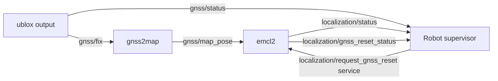

# GNSS recovery interface

This feature reports LiDAR/map consistency and executes an externally requested reset.
It does not navigate, stop the vehicle, select candidates, decide where to retry, or rearm.
GNSS reception/RTK quality belongs to ublox_dgnss. The caller decides whether quality
has held long enough. emcl2 defensively checks position validity, frame, covariance and freshness.

## Connections and ownership

GNSS status/quality is reported by ublox, not emcl2. emcl2 subscribes to calibrated
position; the robot supervisor decides when to request recovery. The diagram describes
integration endpoints; this change does not implement that supervisor.
See [ublox status](../ublox_dgnss/docs/gnss_output_contract.md#受信状況品質status互換launchでは-gnssstatus),
[conversion](../gnss2map/README.md), and [launch integration](../cat_robot/cat_navigation/README.md#要求型gnss自己位置リセットの接続).

## Public interfaces

All names below are relative ROS names, so a namespace/remap applies normally.

| Name | Type | Contract |
| --- | --- | --- |
| `localization/status` | `emcl2_msgs/msg/LocalizationStatus` | 10 Hz and transitions, Reliable/Transient Local/depth 1 |
| `localization/request_gnss_reset` | `emcl2_msgs/srv/RequestGnssReset` | Immediate acceptance/rejection, not completion |
| `localization/gnss_reset_status` | `emcl2_msgs/msg/GnssResetStatus` | 10 Hz after first request and transitions; latest result retained |
| `gnss/map_pose` | `geometry_msgs/msg/PoseWithCovarianceStamped` | SensorDataQoS input; calibrated map-frame antenna position |

`emcl2_msgs` and `emcl2` are separate ROS packages in this repository:
`src/emcl2_ros2/emcl2_msgs` and `src/emcl2_ros2/emcl2`. The repository root has no
package.xml, so normal colcon discovery finds both. Package names and all public
interfaces are unchanged. The [layout migration](docs/validation/emcl2_layout_20261117.md)
records history preservation and fresh-output verification.
The exact fields/constants are in [LocalizationStatus.msg](emcl2_msgs/msg/LocalizationStatus.msg),
[RequestGnssReset.srv](emcl2_msgs/srv/RequestGnssReset.srv), and
[GnssResetStatus.msg](emcl2_msgs/msg/GnssResetStatus.msg).
Do not infer health from message arrival alone. `header.stamp` is publication time;
`scan_stamp` is the last evaluated observation. `instance_id` distinguishes process
restarts and `transition_id` increments on state changes. A late subscriber receives
only the latest state/result, not an event history. Consumers must monitor heartbeat age.

`alpha` is the sampled proportion of particles without laser penetration of mapped
walls, not scan likelihood or proof of unique localization. The existing `alpha`
topic is preserved. Sustained alpha below `lost_alpha_threshold` (default .3) for
`lost_hold_sec` (1 s) marks LOST. Recovery requires alpha >= `recovered_alpha_threshold`
(.7) for `recovered_hold_sec` (2 s). Gaps invalidate dwell continuity. INITIALIZING
means no initialized filter; UNAVAILABLE means missing fresh/evaluated scan (including
missing TF); these are distinct from LOST. Thresholds are initial configurable values,
not calibrated hardware acceptance. High alpha in an uninformative/symmetric map
can be misleading; success means this consistency criterion passed, not ground truth.

## Reset lifecycle

Opt in with `use_gnss_reset:=true` and an explicit `gnss_antenna_frame`. Defaults are off.
No GNSS reset happens merely because LOST or good GNSS is observed. Existing normal
expansion resetting remains unchanged. Manual/autonomous control and motion state are
not reset inputs. A request is allowed while TRACKING as well as LOST.

Requests contain a caller-unique `request_id` (1..128 bytes) and a positive `timeout`
up to `gnss_reset_max_duration` (60 s). BUSY rejects another request while active.
The last 128 accepted request IDs are idempotent for this process, including after
completion; duplicates return the original accepted attempt ID, not a new attempt.
After eviction/restart an ID is no longer remembered; callers must use globally unique IDs.
Rejected requests are not remembered and can be retried. `instance_id/counter` forms attempt IDs.

Acceptance requires an initialized filter, a fresh evaluated scan, antenna TF and
fresh valid GNSS. The next new valid scan injects particles once, never on a duplicate
scan. The complete particle set is sampled from GNSS XY covariance (including XY
correlation), with independent additive `gnss_sigma_floor` (.25 m standard deviation).
Headings are uniform [-pi,pi); each heading corrects the base-to-antenna XY lever arm.
Input orientation is ignored. Planar mounting/attitude is assumed; this is not a 3D
roll/pitch lever-arm model. No fixed forward direction is fabricated.

The cat_navigation launch sets `gnss_antenna_frame` to `gnss_antenna_link`.
The authoritative mounting position is the [cat_robot URDF](../cat_robot/cat_bringup/urdf/experiment_robot.urdf.xacro),
not a second numeric offset in this package. emcl2 looks up
`base_frame_id <- gnss_antenna_frame` at the scan time and subtracts the rotated XY
offset for each sampled heading. Missing TF rejects acceptance or delays pending
injection. Flat planar motion is the adopted robot assumption; Z/roll/pitch correction
is not applied. gnss2map must continue publishing antenna position so this correction
is applied exactly once.

After injection, existing LiDAR updates/expansion resetting continue until sustained
consistency yields SUCCEEDED or a steady-clock deadline yields TIMED_OUT. The injection
scan cannot count as recovery evidence. GNSS expiry after acceptance delays injection
but does not cancel the attempt; it never injects stale coordinates. After injection,
no further GNSS samples are injected within that attempt. External map replacement,
initial pose or global localization terminates an active attempt as FAILED. Mode changes
are irrelevant. A process shutdown has no guaranteed terminal publish; heartbeat loss
must be handled by the caller. Timers execute on the node loop, so deadline reporting
has loop/callback scheduling latency. A terminal reset result is independent of the
current sensor availability state. Failure does not restore old particle coordinates.

`gnss_max_age` defaults to 1 s and is enforced using both ROS source time and monotonic
receipt age. Zero/future/out-of-order stamps, wrong map frame, nonfinite XY and invalid
XY covariance are rejected. A clock jump never makes old measurements fresh; restart
or a later valid timestamp may be required. The latest valid GNSS input is cached until
expiry and is not cleared by map replacement. When changing map/calibration, restart
or reconfigure the conversion/localization pipeline together before issuing requests;
a matching frame name alone does not identify a calibration generation.
The caller must ensure the calibration matches the selected saved map and treat
transform uncertainty/time alignment appropriately before hardware use.

## Ownership and checks

[Package README](emcl2/README.md) owns general localization; [LOCAL_MAINTENANCE](LOCAL_MAINTENANCE.md)
owns workspace maintenance. Conversion is owned by [gnss2map](../gnss2map/README.md),
GNSS status by [the ublox output contract](../ublox_dgnss/docs/gnss_output_contract.md),
and opt-in integration by [cat_navigation](../cat_robot/cat_navigation/README.md).
Exploration/normal-navigation orchestration is outside this feature; the dated
[HANDOFF](../../docs/localization_recovery/HANDOFF.md) records the broader design and
its state before implementation, not a current interface specification.

Tests `test_recovery.cpp` use deterministic clocks and random seeds, no ROS graph.
[test_recovery_ros.py](emcl2/test/test_recovery_ros.py) starts emcl2 on localhost/domain 216
with synthetic map, TF, scans and map-frame GNSS. Its pipeline case additionally starts
ublox's output converter and gnss2map with synthetic UBX inputs. It starts no receiver
driver, NTRIP client, robot, motion client or simulator.
Do not execute legacy `emcl2/test/test.bash` for offline validation.
[Implementation validation](docs/validation/gnss_reset_20261117.md) records the
83 individual offline cases and links the generated command/log evidence. These results
belong to that implementation, not to every future checkout. See the separate
[documentation review](docs/validation/gnss_docs_review_20261117.md) for this prose-only check.
Offline checks do not establish hardware localization accuracy.
